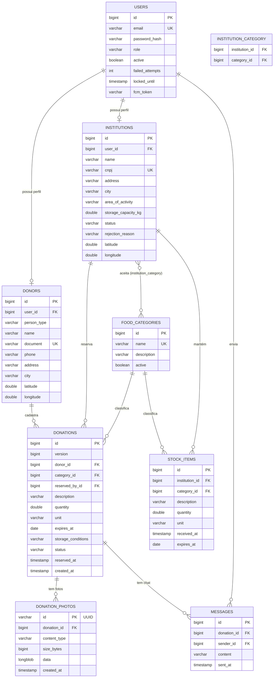

# Modelo de domínio e regras de negócio

## Entidades

| Entidade | Papel | Relacionamentos |
|---|---|---|
| **User** | Conta de acesso (e-mail, senha, perfil `DONOR`, `INSTITUTION` ou `ADMIN`, token FCM) | 1:1 com Donor ou Institution |
| **Donor** | Doador (pessoa física ou empresa), com localização | 1:N com Donation |
| **Institution** | Instituição que recebe e distribui alimentos, com status de aprovação | **N:N com FoodCategory**; 1:N com Donation (reservas) e StockItem |
| **FoodCategory** | Categoria de alimento, gerenciada pelo administrador | N:N com Institution; 1:N com Donation e StockItem |
| **Donation** | Doação de alimento (quantidade, validade, status) | N:1 com Donor, FoodCategory e Institution (quem reservou) |
| **StockItem** | Item no estoque de uma instituição | N:1 com Institution e FoodCategory |
| **Message** | Mensagem do chat de uma doação | N:1 com Donation e User |

Entidades avaliadas na disciplina de Back-end (CRUD completo): **Donor, Institution, Donation e FoodCategory**.

### Relacionamentos pedidos pela disciplina

- **Um-para-muitos:** um `Donor` possui várias `Donation` (`donations.donor_id`). Também valem `Institution` → `StockItem` e `FoodCategory` → `Donation`.
- **Muitos-para-muitos:** `Institution` ↔ `FoodCategory`, pela tabela `institution_category`. Uma instituição aceita várias categorias e uma categoria é aceita por várias instituições.

## DER

## Regras de negócio

### Doação
1. Só doador com cadastro completo cria doação. A validade não pode estar no passado e a quantidade deve ser maior que zero. Unidades aceitas: `kg`, `un`, `L`.
2. A doação nasce `AVAILABLE`. Fluxo: `AVAILABLE → RESERVED → DELIVERED`, com `CANCELLED` (doador) e `EXPIRED` (sistema).
3. Só se edita doação `AVAILABLE`. Só se exclui doação `AVAILABLE`, `CANCELLED` ou `EXPIRED`.
4. Validade de até 3 dias é **prioritária** (destaque no app).
5. Uma instituição pode ter no máximo **5 reservas ativas** (`RESERVED`).
6. Reserva não coletada em **24 h** volta para `AVAILABLE` (rotina a cada 5 min). Doação disponível vencida vira `EXPIRED`.
7. Duas instituições nunca reservam a mesma doação: há controle de concorrência (`@Version`) e a segunda recebe `409`.
8. Ao confirmar o recebimento, a instituição ganha um item no estoque e a doação vira `DELIVERED`.

### Instituição ↔ categoria (N:N)
9. Na criação, a instituição **escolhe ao menos uma categoria** de alimento que aceita. Ela nunca fica sem categorias: remover a última é bloqueado.
10. A **busca** só mostra doações das categorias que a instituição aceita, dentro do raio (padrão 50 km), ordenadas por proximidade.
11. A instituição só consegue **solicitar** doações de categorias que aceita (`409` caso contrário).
12. **Notificações** de nova doação só vão para instituições aprovadas que aceitam a categoria e estão dentro do raio.
13. Só o administrador cria, edita e exclui categorias. Categoria em uso (doações, estoque ou instituições) **não pode ser excluída**: deve ser desativada. Categoria inativa não aceita novas doações nem novos vínculos.

### Cadastro e acesso
14. Cadastro público só para `DONOR` e `INSTITUTION`. Instituição nasce `PENDING` e só busca e solicita depois de aprovada pelo admin.
15. CPF e CNPJ têm os dígitos verificadores validados e não se repetem.
16. 3 logins errados bloqueiam a conta por 30 minutos. Logout invalida o token.

## Requisito funcional do WebSocket (RF-WS)

> **RF-WS: Chat e notificações em tempo real.** Depois que uma instituição reserva uma doação, o doador e a instituição conversam por um chat vinculado à doação, com entrega imediata e histórico salvo. Todo usuário conectado também recebe, em tempo real, avisos de eventos do sistema: nova doação compatível com as categorias da instituição, doação reservada, cancelada, entregue, reserva liberada e cadastro de instituição aprovado, rejeitado ou pendente (para o admin).

- Endpoint: `ws://host/ws?token=<JWT>` (`wss://` em produção). Sem token válido, a conexão é recusada (401).
- Mensagens (JSON):
  - cliente → servidor: `{"type":"chat","donationId":10,"content":"texto"}` e `{"type":"ping"}`;
  - servidor → cliente: `connected`, `chat`, `notification`, `pong` e `error`.
- Demonstração: `/ws-demo/index.html`, aberta em duas janelas (doador e instituição).
- O mesmo evento que vai pelo WebSocket também dispara **push (FCM)** no celular, quando o usuário registrou o token.
